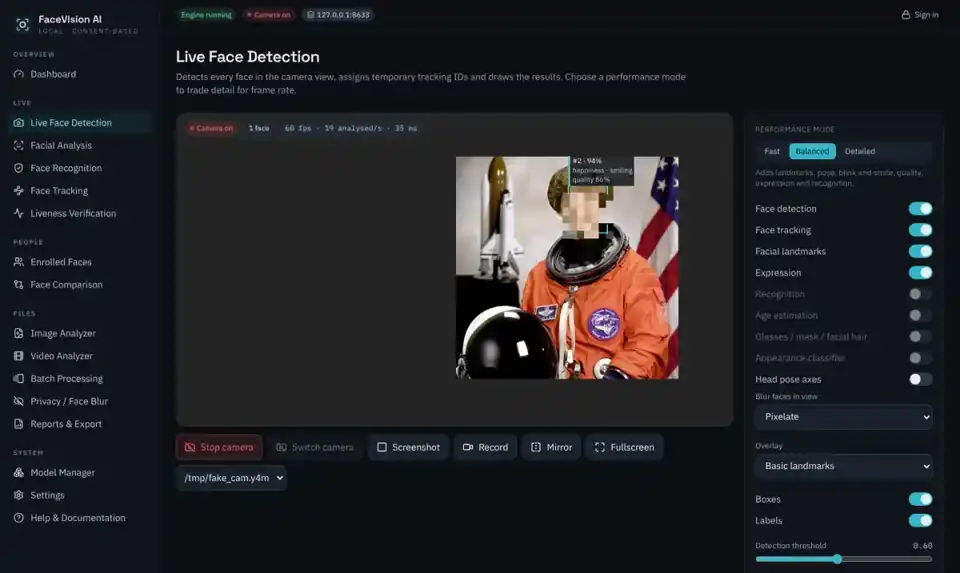

# FaceVision AI

**Website: <https://shahrukhalid.github.io/facevision-ai/>**

**Local, consent-based face detection, analysis, recognition and anonymisation.** Runs on your own computer with open models, works offline after setup, and never uploads faces anywhere.

[](https://github.com/Shahrukhalid/facevision-ai/actions/workflows/ci.yml)
[](LICENSE)

%20·%20Windows%2010%2F11%20·%20Linux-informational)



FaceVision AI is a FastAPI + React application with a modular computer-vision engine. It detects and tracks faces in a webcam, photo, video or RTSP stream, measures landmarks, head pose, blinks, smiles and image quality, and can recognise people **only if they were enrolled on your computer with their consent**. A privacy toolkit blurs, pixelates or masks faces without any recognition at all.

## What it does

| Area | What you get | Status |
| --- | --- | --- |
| Face detection | Multiple faces, small to large, adjustable threshold, confidence, low-confidence flag, face count, FPS and latency | Tested |
| Tracking | Temporary IDs, enter/exit events, smoothed boxes, track expiry, statistics | Tested |
| Landmarks | 478-point face mesh (MediaPipe), basic / detailed / full-mesh overlays, head pose axes | Tested |
| Facial analysis | Head pose and direction, eye state and blink count, mouth state, smile, symmetry and proportions, image quality, occlusion indicators | Tested |
| Expression | 8 FER+ classes with probabilities and an uncertainty flag (describes the visible expression, not feelings) | Tested |
| Age | Shown as a range: CLIP zero-shot brackets (experimental) or InsightFace estimate (research pack) | Tested, experimental |
| Attributes | Eyeglasses, sunglasses, face mask, beard, mustache via CLIP zero-shot | Tested, experimental |
| Appearance classifier | Optional, **off by default**, never presented as gender identity | Tested |
| Recognition | Consented enrolment, encrypted templates, 1:1 verification, 1:N matching, Unknown for non-matches, ambiguity and quality checks, duplicate warnings | Tested |
| Comparison | Two photos, face selection, aligned crops, similarity vs threshold | Tested |
| Liveness | Random blink / turn / smile challenges plus passive photo/screen detection, with stated limits | Tested (see [limits](docs/LIVENESS.md)) |
| Photos, videos, batches | Annotated exports, entry/exit logs, background jobs with progress and cancellation, JSON/CSV/TXT reports | Tested |
| Privacy | Blur / pixelate / solid mask, per-face selection, preview, photo and video export, retention and cache deletion | Tested |
| Live camera | Start/stop, switch camera, screenshot, recording, fullscreen, mirror, performance modes, blur-in-view | Tested with a fake camera in Chromium; real webcams need a manual check |
| Server-side sources | Local camera index or RTSP/HTTP stream opened by the server | Experimental, not tested against real IP cameras |
| Desktop package | PyInstaller app bundle | Built and smoke-tested in CI, see [packaging](docs/PACKAGING.md) |

The [feature report](docs/FEATURES.md) lists exactly how each item was tested and what is not done.

## Privacy by design

- **Everything stays on your computer.** No cloud APIs, no accounts, no analytics. ONNX Runtime's built-in telemetry is switched off, and a test fails the build if analysis makes any network connection.
- **Consent first.** Enrolment requires confirming the person's informed consent. Recognition only compares against people enrolled locally; it never searches the internet or other databases.
- **Encrypted templates.** Face templates are encrypted with AES-256-GCM. The key is unlocked only by your passphrase or API key, so a copied database is not enough to read them. Enrolment photos are not kept.
- **Visible camera use.** The camera starts only when you press Start, a red indicator shows while it is on, and nothing is recorded unless you press Record or Screenshot.
- **Local only.** The server listens on `127.0.0.1` and rejects other hosts and cross-site requests.
- **No sensitive inferences.** No race, ethnicity, religion, health, sexual orientation or similar traits, ever.

More in [docs/PRIVACY.md](docs/PRIVACY.md) and [SECURITY.md](SECURITY.md).

## Quick start

Requirements: **Python 3.10–3.13**, **Node.js 20+** (to build the web app) and about 1 GB of disk space.

**macOS / Linux**

```bash
git clone https://github.com/Shahrukhalid/facevision-ai.git
cd facevision-ai
bash scripts/setup.sh     # virtual environment, web app build, default models (~80 MB, checksum-verified)
bash scripts/start.sh     # opens http://localhost:8600
```

**Windows (PowerShell)**

```powershell
git clone https://github.com/Shahrukhalid/facevision-ai.git
cd facevision-ai
powershell -ExecutionPolicy Bypass -File scripts\setup.ps1
powershell -ExecutionPolicy Bypass -File scripts\start.ps1
```

Step-by-step guides with camera permissions and hardware acceleration: [macOS](docs/INSTALL-macOS.md) · [Windows](docs/INSTALL-Windows.md).

## Models and licences

| Task | Model | Licence | Default |
| --- | --- | --- | --- |
| Detection | [YuNet](https://github.com/opencv/opencv_zoo/tree/main/models/face_detection_yunet) (OpenCV Zoo) | MIT | Yes |
| Recognition | [SFace](https://github.com/opencv/opencv_zoo/tree/main/models/face_recognition_sface) (OpenCV Zoo) | Apache-2.0 | Yes |
| Landmarks, blendshapes, pose | [MediaPipe Face Landmarker](https://ai.google.dev/edge/mediapipe/solutions/vision/face_landmarker) | Apache-2.0 | Yes |
| Expression | [FER+](https://github.com/onnx/models/tree/main/validated/vision/body_analysis/emotion_ferplus) (ONNX Model Zoo) | MIT | Yes |
| Passive anti-spoofing | [Silent-Face MiniFASNet](https://github.com/minivision-ai/Silent-Face-Anti-Spoofing), converted to ONNX | Apache-2.0 | Yes |
| Attributes, age brackets | [CLIP ViT-B/32](https://huggingface.co/openai/clip-vit-base-patch32), converted to ONNX | MIT | Optional (350 MB) |
| Age, appearance, ArcFace | [InsightFace buffalo_s](https://github.com/deepinsight/insightface) | **Non-commercial research only** | Opt-in after accepting its licence |

Every file has a pinned SHA-256 checksum. Converted models are rebuilt from source by a [reproducible workflow](.github/workflows/model-pack.yml). Details: [docs/MODELS.md](docs/MODELS.md).

## Measured performance

Measured with `python -m facevision bench` (one face in a 1280×720 frame; mean latency per frame):

| Machine | Fast | Balanced | Detailed |
| --- | --- | --- | --- |
| macOS 14, Apple Silicon (GitHub CI runner) | 9 ms (106 fps) | 29 ms (35 fps) | 44 ms (23 fps) |
| Windows Server 2022 (GitHub CI runner) | 8 ms (124 fps) | 31 ms (32 fps) | 54 ms (19 fps) |
| Linux x86-64, 2 vCPU (development container) | 5 ms (189 fps) | 23 ms (43 fps) | 52 ms (19 fps) |

CI runners are shared virtual machines without a GPU. Per-stage timings and p95 latencies: [docs/BENCHMARKS.md](docs/BENCHMARKS.md). Run the benchmark on your own machine for real numbers.

## Recognition accuracy

On the AT&T Database of Faces (40 consenting volunteers, 400 images), SFace at the default threshold of 0.363 produced **0 false non-matches in 1,800 genuine pairs and 0.17% false matches in 78,000 impostor pairs**; rank-1 identification was 100%. This is a small, controlled dataset, so expect lower accuracy on everyday photos. Method, full results and how to evaluate on your own consented data, including per-group error rates: [docs/EVALUATION.md](docs/EVALUATION.md).

## API

A documented REST API and WebSocket stream run alongside the app. Interactive docs are at `http://localhost:8600/api/docs`.

```bash
curl -F file=@photo.jpg http://localhost:8600/api/detect
curl -F file=@photo.jpg -F 'options={"preset":"detailed"}' http://localhost:8600/api/analyze
curl -F file=@photo.jpg -F method=pixelate -o hidden.jpg http://localhost:8600/api/anonymize
curl -H "X-API-Key: fv_..." -F file=@photo.jpg http://localhost:8600/api/recognize
```

See [docs/API.md](docs/API.md) for every endpoint.

## Documentation

- [Installation on macOS](docs/INSTALL-macOS.md) and [on Windows](docs/INSTALL-Windows.md)
- [Features and test status](docs/FEATURES.md)
- [API reference](docs/API.md)
- [Models, licences and compatibility](docs/MODELS.md)
- [Privacy](docs/PRIVACY.md) and [security policy](SECURITY.md)
- [Liveness limitations](docs/LIVENESS.md)
- [Evaluation](docs/EVALUATION.md) and [benchmarks](docs/BENCHMARKS.md)
- [Developer guide](docs/DEVELOPER.md) and [packaging](docs/PACKAGING.md)
- [Troubleshooting](docs/TROUBLESHOOTING.md)
- [Contributing](CONTRIBUTING.md) and [changelog](CHANGELOG.md)

## Responsible use

Face recognition can harm people when it is used without their knowledge. FaceVision AI is built for consent-based, local use: enrolling people who agreed to it, analysing your own photos and videos, and anonymising footage before sharing it. Do not use it for covert surveillance, and check the laws that apply to biometric data where you live (for example the GDPR in the EU/UK and BIPA in Illinois).

## License

[MIT](LICENSE) for the code. Models keep their own licences, listed above and in the app's Model Manager.
